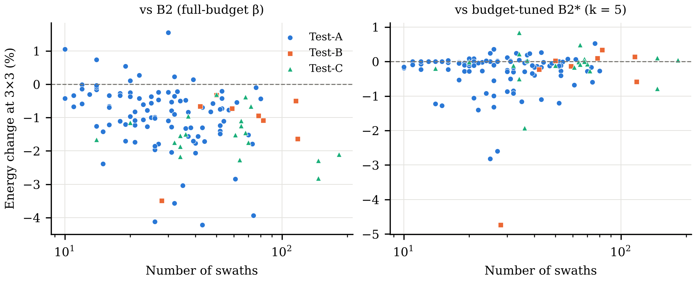

# Supplementary material

All values: energy of the selected evolved heuristic relative to the budget-tuned control B2* (%, negative = less energy), fields as the unit (mean over 10 ACO seeds per field). 95 % CIs: percentile bootstrap over fields (4000 resamples). HL = Hodges-Lehmann median of paired differences. B2* uses k = 8 (1x1), 5 (3x3), 2 (5x10), 1 (15x40), selected on validation.

## S1. Effects versus B2* on the 128 test fields

| Heuristic | Budget | Mean | 95 % CI (mean) | Median | 95 % CI (median) | HL | Fields improved | SD over fields |
|---|---|---|---|---|---|---|---|---|
| qwen2.5-coder:7b (T3) | 1x1 | -0.03 | [-0.19, +0.11] | +0.02 | [-0.00, +0.09] | +0.02 | 41 % | 0.88 |
| qwen2.5-coder:7b (T3) | 3x3 | -0.27 | [-0.39, -0.17] | -0.08 | [-0.13, -0.03] | -0.13 | 66 % | 0.65 |
| qwen2.5-coder:7b (T3) | 5x10 | -0.14 | [-0.23, -0.07] | -0.05 | [-0.08, -0.01] | -0.07 | 59 % | 0.50 |
| qwen2.5-coder:7b (T3) | 15x40 | -0.03 | [-0.12, +0.06] | +0.00 | [-0.03, +0.00] | -0.01 | 48 % | 0.54 |
| qwen3.5:9b (T3+repair) | 1x1 | +0.23 | [+0.02, +0.43] | +0.22 | [+0.04, +0.36] | +0.22 | 39 % | 1.18 |
| qwen3.5:9b (T3+repair) | 3x3 | -0.23 | [-0.39, -0.08] | -0.02 | [-0.11, +0.02] | -0.08 | 53 % | 0.93 |
| qwen3.5:9b (T3+repair) | 5x10 | -0.16 | [-0.26, -0.07] | -0.04 | [-0.09, -0.01] | -0.09 | 59 % | 0.55 |
| qwen3.5:9b (T3+repair) | 15x40 | -0.12 | [-0.23, -0.02] | -0.04 | [-0.09, +0.00] | -0.07 | 56 % | 0.60 |
| qwen3.5:9b (T3) | 1x1 | +0.26 | [+0.10, +0.41] | +0.29 | [+0.18, +0.43] | +0.32 | 23 % | 0.86 |
| qwen3.5:9b (T3) | 3x3 | -0.14 | [-0.27, -0.02] | +0.00 | [-0.05, +0.05] | -0.01 | 48 % | 0.75 |
| qwen3.5:9b (T3) | 5x10 | -0.14 | [-0.20, -0.08] | -0.05 | [-0.09, -0.01] | -0.08 | 65 % | 0.38 |
| qwen3.5:9b (T3) | 15x40 | -0.10 | [-0.18, -0.02] | -0.03 | [-0.09, -0.01] | -0.08 | 61 % | 0.45 |
| qwen3.5:9b (T2) | 1x1 | +0.22 | [+0.07, +0.35] | +0.23 | [+0.15, +0.34] | +0.25 | 24 % | 0.82 |
| qwen3.5:9b (T2) | 3x3 | -0.17 | [-0.29, -0.07] | -0.01 | [-0.05, +0.01] | -0.05 | 54 % | 0.67 |
| qwen3.5:9b (T2) | 5x10 | -0.12 | [-0.20, -0.05] | -0.02 | [-0.05, -0.00] | -0.05 | 59 % | 0.43 |
| qwen3.5:9b (T2) | 15x40 | -0.11 | [-0.20, -0.02] | -0.01 | [-0.05, +0.00] | -0.06 | 58 % | 0.50 |
| qwen3.5:9b (T1) | 1x1 | +0.09 | [+0.01, +0.16] | +0.04 | [+0.01, +0.09] | +0.06 | 35 % | 0.42 |
| qwen3.5:9b (T1) | 3x3 | -0.03 | [-0.07, +0.00] | -0.00 | [-0.02, +0.00] | -0.01 | 50 % | 0.22 |
| qwen3.5:9b (T1) | 5x10 | +0.12 | [+0.05, +0.20] | +0.00 | [-0.02, +0.03] | +0.02 | 47 % | 0.43 |
| qwen3.5:9b (T1) | 15x40 | +0.23 | [+0.12, +0.35] | +0.04 | [+0.00, +0.11] | +0.11 | 34 % | 0.67 |
| qwen3.5-9b API (T3) | 1x1 | -0.02 | [-0.22, +0.18] | -0.03 | [-0.14, +0.01] | -0.05 | 52 % | 1.15 |
| qwen3.5-9b API (T3) | 3x3 | +0.08 | [-0.11, +0.27] | +0.02 | [+0.00, +0.12] | +0.08 | 34 % | 1.12 |
| qwen3.5-9b API (T3) | 5x10 | +0.41 | [+0.23, +0.61] | +0.20 | [+0.10, +0.41] | +0.32 | 20 % | 1.09 |
| qwen3.5-9b API (T3) | 15x40 | +0.59 | [+0.42, +0.78] | +0.39 | [+0.23, +0.61] | +0.49 | 16 % | 1.05 |
| claude-haiku-5.5 (T3) | 1x1 | +0.57 | [+0.42, +0.72] | +0.59 | [+0.46, +0.73] | +0.58 | 20 % | 0.87 |
| claude-haiku-5.5 (T3) | 3x3 | +0.02 | [-0.12, +0.15] | +0.15 | [+0.09, +0.18] | +0.13 | 27 % | 0.76 |
| claude-haiku-5.5 (T3) | 5x10 | +0.02 | [-0.05, +0.09] | +0.03 | [+0.00, +0.05] | +0.03 | 39 % | 0.40 |
| claude-haiku-5.5 (T3) | 15x40 | -0.05 | [-0.13, +0.02] | -0.01 | [-0.03, +0.00] | -0.02 | 53 % | 0.42 |
| gpt-6-luna (T3) | 1x1 | +0.90 | [+0.59, +1.22] | +0.64 | [+0.49, +0.79] | +0.68 | 20 % | 1.85 |
| gpt-6-luna (T3) | 3x3 | +0.15 | [-0.11, +0.38] | +0.09 | [+0.00, +0.21] | +0.11 | 41 % | 1.43 |
| gpt-6-luna (T3) | 5x10 | +0.08 | [-0.14, +0.27] | +0.01 | [-0.00, +0.07] | +0.04 | 44 % | 1.17 |
| gpt-6-luna (T3) | 15x40 | +0.00 | [-0.16, +0.17] | +0.00 | [-0.01, +0.01] | +0.00 | 46 % | 0.94 |
| gpt-6-sol (T3) | 1x1 | +0.14 | [-0.02, +0.30] | +0.10 | [+0.05, +0.16] | +0.11 | 38 % | 0.93 |
| gpt-6-sol (T3) | 3x3 | -0.13 | [-0.27, -0.01] | -0.00 | [-0.04, +0.00] | -0.02 | 51 % | 0.75 |
| gpt-6-sol (T3) | 5x10 | -0.05 | [-0.15, +0.03] | +0.00 | [-0.02, +0.05] | +0.00 | 44 % | 0.53 |
| gpt-6-sol (T3) | 15x40 | +0.04 | [-0.08, +0.15] | +0.00 | [-0.00, +0.07] | +0.04 | 41 % | 0.65 |

## S2. Per test set (mean versus B2*, 95 % CI)

| Heuristic | Budget | Test-A (n=100) | Test-B (n=8) | Test-C (n=20) |
|---|---|---|---|---|
| qwen2.5-coder:7b (T3) | 3x3 | -0.27 [-0.38, -0.18] | -0.64 [-1.82, +0.09] | -0.12 [-0.38, +0.08] |
| qwen2.5-coder:7b (T3) | 5x10 | -0.12 [-0.20, -0.04] | -0.51 [-1.48, +0.05] | -0.12 [-0.26, -0.00] |
| qwen2.5-coder:7b (T3) | 15x40 | +0.04 [-0.06, +0.15] | -0.10 [-0.46, +0.23] | -0.37 [-0.61, -0.16] |
| qwen3.5:9b (T3+repair) | 3x3 | -0.22 [-0.37, -0.07] | -0.86 [-2.53, +0.15] | -0.02 [-0.25, +0.19] |
| qwen3.5:9b (T3+repair) | 5x10 | -0.12 [-0.21, -0.04] | -0.68 [-1.74, -0.04] | -0.12 [-0.25, +0.00] |
| qwen3.5:9b (T3+repair) | 15x40 | -0.02 [-0.12, +0.08] | -0.64 [-1.43, -0.10] | -0.42 [-0.66, -0.23] |
| qwen3.5:9b (T3) | 3x3 | -0.12 [-0.25, -0.01] | -0.74 [-2.12, +0.04] | +0.03 [-0.20, +0.20] |
| qwen3.5:9b (T3) | 5x10 | -0.12 [-0.17, -0.07] | -0.48 [-1.27, -0.01] | -0.09 [-0.19, +0.02] |
| qwen3.5:9b (T3) | 15x40 | -0.04 [-0.13, +0.05] | -0.24 [-0.55, -0.00] | -0.34 [-0.54, -0.16] |
| qwen3.5:9b (T2) | 3x3 | -0.17 [-0.28, -0.06] | -0.58 [-1.72, +0.10] | -0.04 [-0.23, +0.14] |
| qwen3.5:9b (T2) | 5x10 | -0.09 [-0.15, -0.04] | -0.46 [-1.40, +0.03] | -0.12 [-0.24, -0.00] |
| qwen3.5:9b (T2) | 15x40 | -0.06 [-0.15, +0.04] | -0.15 [-0.37, +0.02] | -0.37 [-0.62, -0.16] |
| qwen3.5:9b (T1) | 3x3 | -0.03 [-0.08, +0.01] | -0.07 [-0.16, +0.02] | -0.00 [-0.06, +0.05] |
| qwen3.5:9b (T1) | 5x10 | +0.14 [+0.06, +0.24] | +0.09 [-0.05, +0.29] | +0.01 [-0.11, +0.14] |
| qwen3.5:9b (T1) | 15x40 | +0.29 [+0.16, +0.42] | +0.49 [+0.03, +1.13] | -0.16 [-0.38, +0.05] |
| qwen3.5-9b API (T3) | 3x3 | +0.15 [-0.03, +0.36] | -0.84 [-2.60, +0.15] | +0.08 [-0.12, +0.28] |
| qwen3.5-9b API (T3) | 5x10 | +0.51 [+0.31, +0.74] | -0.25 [-1.29, +0.38] | +0.19 [-0.03, +0.40] |
| qwen3.5-9b API (T3) | 15x40 | +0.70 [+0.50, +0.92] | +0.46 [+0.19, +0.75] | +0.10 [-0.24, +0.43] |
| claude-haiku-5.5 (T3) | 3x3 | +0.01 [-0.14, +0.15] | -0.47 [-1.42, +0.15] | +0.25 [+0.07, +0.40] |
| claude-haiku-5.5 (T3) | 5x10 | +0.05 [-0.01, +0.11] | -0.45 [-1.28, +0.03] | +0.09 [+0.01, +0.18] |
| claude-haiku-5.5 (T3) | 15x40 | +0.03 [-0.03, +0.07] | -0.53 [-1.43, +0.04] | -0.22 [-0.34, -0.10] |
| gpt-6-luna (T3) | 3x3 | +0.19 [-0.03, +0.44] | -0.51 [-3.17, +1.21] | +0.19 [-0.12, +0.50] |
| gpt-6-luna (T3) | 5x10 | +0.14 [-0.03, +0.35] | -0.55 [-2.84, +0.90] | -0.00 [-0.20, +0.19] |
| gpt-6-luna (T3) | 15x40 | +0.09 [-0.06, +0.27] | -0.30 [-1.80, +0.77] | -0.33 [-0.66, -0.07] |
| gpt-6-sol (T3) | 3x3 | -0.11 [-0.25, +0.01] | -0.63 [-2.00, +0.20] | +0.00 [-0.11, +0.10] |
| gpt-6-sol (T3) | 5x10 | +0.01 [-0.07, +0.08] | -0.68 [-1.73, -0.08] | -0.10 [-0.31, +0.07] |
| gpt-6-sol (T3) | 15x40 | +0.16 [+0.06, +0.27] | -0.55 [-1.27, -0.03] | -0.33 [-0.68, -0.04] |

## S3. Run level: every evolution run on the 128 test fields (mean energy vs B2*, %)

| Configuration | Budget | Runs | Run means | Mean | SD |
|---|---|---|---|---|---|
| qwen2.5-coder:7b (T3) | 3x3 | 3 | -0.27, -0.09, -0.09 | -0.15 | 0.11 |
| qwen2.5-coder:7b (T3) | 5x10 | 3 | -0.14, -0.01, -0.02 | -0.06 | 0.07 |
| qwen3.5:9b (T1) | 3x3 | 3 | +0.04, +0.06, -0.03 | +0.02 | 0.05 |
| qwen3.5:9b (T1) | 5x10 | 3 | +0.29, +0.32, +0.12 | +0.24 | 0.11 |
| qwen3.5:9b (T2) | 3x3 | 3 | -0.17, -0.00, -0.05 | -0.07 | 0.09 |
| qwen3.5:9b (T2) | 5x10 | 3 | -0.12, +0.07, +0.03 | -0.00 | 0.10 |
| qwen3.5:9b (T3+repair) | 3x3 | 3 | +0.33, -0.23, -0.10 | -0.00 | 0.29 |
| qwen3.5:9b (T3+repair) | 5x10 | 3 | +0.27, -0.16, -0.05 | +0.02 | 0.22 |
| qwen3.5:9b (T3) | 3x3 | 5 | -0.09, -0.14, +0.35, -0.06, +0.13 | +0.04 | 0.20 |
| qwen3.5:9b (T3) | 5x10 | 5 | -0.10, -0.14, +0.19, -0.05, +0.19 | +0.02 | 0.16 |
| gpt-6-luna (T3) | 3x3 | 5 | +0.63, +0.15, -0.09, +0.07, +0.79 | +0.31 | 0.38 |
| gpt-6-luna (T3) | 5x10 | 5 | +0.35, +0.08, +0.01, -0.06, +0.46 | +0.17 | 0.23 |
| gpt-6-sol (T3) | 3x3 | 1 | -0.13 | -0.13 | - |
| gpt-6-sol (T3) | 5x10 | 1 | -0.05 | -0.05 | - |
| claude-haiku-5.5 (T3) | 3x3 | 3 | +0.02, +0.06, +0.05 | +0.04 | 0.02 |
| claude-haiku-5.5 (T3) | 5x10 | 3 | +0.02, -0.05, +0.01 | -0.01 | 0.04 |
| qwen3.5-9b API (T3) | 3x3 | 1 | +0.08 | +0.08 | - |
| qwen3.5-9b API (T3) | 5x10 | 1 | +0.41 | +0.41 | - |

Local (qwen2.5-coder, qwen3.5 T1-T3, repair) versus API (luna, haiku, sol, parity) runs, two-sided Mann-Whitney on run means:

- 3x3: local -0.02 % (n=17), API +0.16 % (n=10), p = 0.047
- 5x10: local +0.04 % (n=17), API +0.12 % (n=10), p = 0.328

## S4. Turn-term knock-out (same programs with the turn factor set to 1), mean vs B2* [95 % CI]

| Program | 3x3 | 5x10 |
|---|---|---|
| qwen2.5-coder:7b (T3) with turn term | -0.27 | -0.14 |
| qwen2.5-coder:7b (T3) without turn term | -0.20 [-0.32, -0.10] | -0.07 [-0.16, +0.02] |
| qwen3.5:9b (T2) with turn term | -0.17 | -0.12 |
| qwen3.5:9b (T2) without turn term | -0.01 [-0.10, +0.06] | -0.01 [-0.02, +0.01] |
| qwen3.5:9b (T3) with turn term | -0.14 | -0.14 |
| qwen3.5:9b (T3) without turn term | -0.03 [-0.14, +0.07] | -0.04 [-0.10, +0.00] |

## S5. Sensitivity to the U-turn cost (Test-A, 100 fields; k of B2* not re-selected)

| c_turn | Budget | Heuristic | vs B2 | vs B2* [95 % CI] | Wilcoxon p (one-sided) |
|---|---|---|---|---|---|
| x05 | 3x3 | qwen2.5-coder:7b (T3) | -0.99 | -0.26 [-0.36, -0.16] | 3.9e-07 |
| x05 | 3x3 | qwen3.5:9b (T2) | -0.89 | -0.15 [-0.26, -0.04] | 3.0e-02 |
| x05 | 3x3 | qwen3.5:9b (T3) | -0.85 | -0.11 [-0.23, +0.01] | 3.1e-01 |
| x05 | 5x10 | qwen2.5-coder:7b (T3) | -0.61 | -0.12 [-0.19, -0.04] | 2.6e-04 |
| x05 | 5x10 | qwen3.5:9b (T2) | -0.60 | -0.10 [-0.17, -0.05] | 9.1e-05 |
| x05 | 5x10 | qwen3.5:9b (T3) | -0.60 | -0.10 [-0.16, -0.06] | 1.9e-04 |
| x2 | 3x3 | qwen2.5-coder:7b (T3) | -0.95 | -0.26 [-0.37, -0.16] | 2.6e-06 |
| x2 | 3x3 | qwen3.5:9b (T2) | -0.88 | -0.18 [-0.29, -0.07] | 1.1e-02 |
| x2 | 3x3 | qwen3.5:9b (T3) | -0.82 | -0.12 [-0.24, -0.01] | 1.1e-01 |
| x2 | 5x10 | qwen2.5-coder:7b (T3) | -0.56 | -0.09 [-0.18, +0.00] | 3.4e-02 |
| x2 | 5x10 | qwen3.5:9b (T2) | -0.56 | -0.09 [-0.16, -0.02] | 1.3e-03 |
| x2 | 5x10 | qwen3.5:9b (T3) | -0.56 | -0.09 [-0.15, -0.03] | 6.8e-04 |

## S6. Error analysis (3x3, qwen2.5-coder:7b heuristic)

- Gain over B2 (full-budget β) grows with field size: Spearman rho = -0.33 with the number of swaths (p = 1.0e-04).
- The residual over B2* does not depend on size: rho = +0.04 (p = 0.61).
- Largest gains over B2*: testB/nl_field_18 -4.73 %, testA/nl_field_69 -2.82 %, testA/lt_field_286 -2.60 %; largest losses: testC/TH-KK-11 +0.48 %, testA/ee_field_92 +0.52 %, testC/TH-KK-03 +0.84 %.
- Within-field seed variability at 3x3: coefficient of variation 0.35 % per run (standard error with 10 seeds about 0.11 %).

Figure S1. Per-field energy change of the qwen2.5-coder:7b heuristic at 3x3 versus field size, relative to B2 with full-budget β (left) and to the budget-tuned B2* (right).

## S7. Statistical notes

- Table 2 of the paper reports one-sided Wilcoxon tests in both directions (less and more energy), in families of 12 planners (vs B2) and 9 (vs B2*) per budget and direction, 87 distinct comparisons per direction (B2* = B2 at 15x40 and 30x150). Holm correction is applied within each family, and each direction is tested at Holm-corrected p < 0.025, so the pair of one-sided tests corresponds to a two-sided test at alpha = 0.05. The main 'less energy' claims also hold under Bonferroni correction over the 87 comparisons (raw p < 0.025/87) except qwen3.5:9b T3+repair and T2 at 5x10 against B2* (raw p = 8e-4 and 5e-4).
- CPU times are single-core times measured while 16 evaluation workers ran in parallel on one server; ratios are indicative and depend on the Python implementation.
- Equivalent-compute ratios interpolate the mean energy-budget curve log-linearly between five budgets and carry no uncertainty estimate.

## S8. Noise of the training fitness (train_v2, T25 parameters, ACO 3x3, 30 fields)

Evolution scored every program on ACO seeds 0-2. Re-scoring on seeds 3-14 (four further triples) gives:

| Program | Fitness, seeds 0-2 | Fitness, seeds 3-14 | Change | SD over 5 triples (rel.) | vs k = 5, seeds 0-14 |
|---|---|---|---|---|---|
| seed heuristic (B2) | 0.9323 | 0.9333 | +0.11 % | 0.11 % | +1.68 % |
| k = 5 control (B2*) | 0.9173 | 0.9178 | +0.05 % | 0.04 % | +0.00 % |
| qwen2.5-coder:7b (T3) | 0.9122 | 0.9141 | +0.21 % | 0.11 % | -0.43 % |
| qwen3.5:9b (T3) | 0.9153 | 0.9173 | +0.22 % | 0.11 % | -0.09 % |

Script: analysis/noise_check_v2.py.

## S9. Heuristic interface (moved from the paper)

The heuristic receives one value per candidate (except energy_left_frac, one value per decision) and returns one positive score per candidate.

| Input | Meaning | Template |
|---|---|---|
| dist_m | distance from current position to candidate start (m) | T1-T3 |
| turn_deg | turning needed to align with the candidate (deg) | T2, T3 |
| swath_len_m | candidate swath length (m) | T2, T3 |
| energy_left_frac | usable battery left in the sortie (scalar, 0-1) | T3 |
| depot_dist_m | distance from candidate end to depot (m) | T3 |
| fits | 1 if travel + swath + return fits the battery, else 0 | T3 |

Inputs hidden by a template are replaced by constants during evolution and testing.
